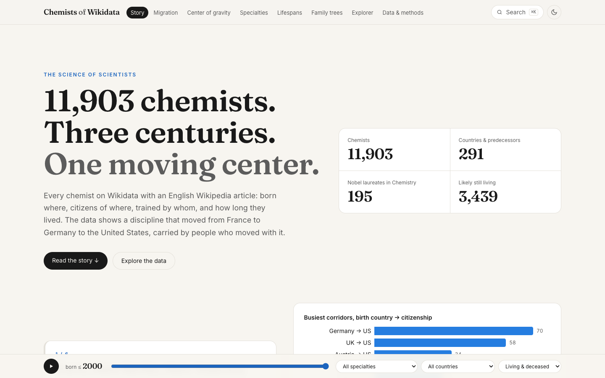
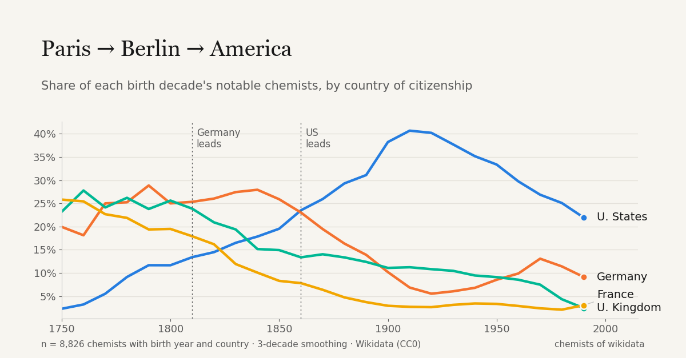
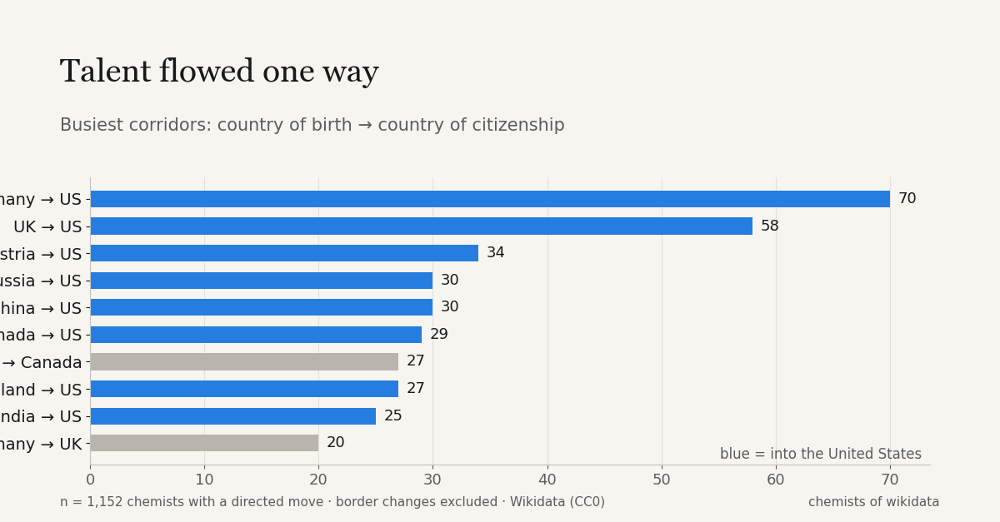
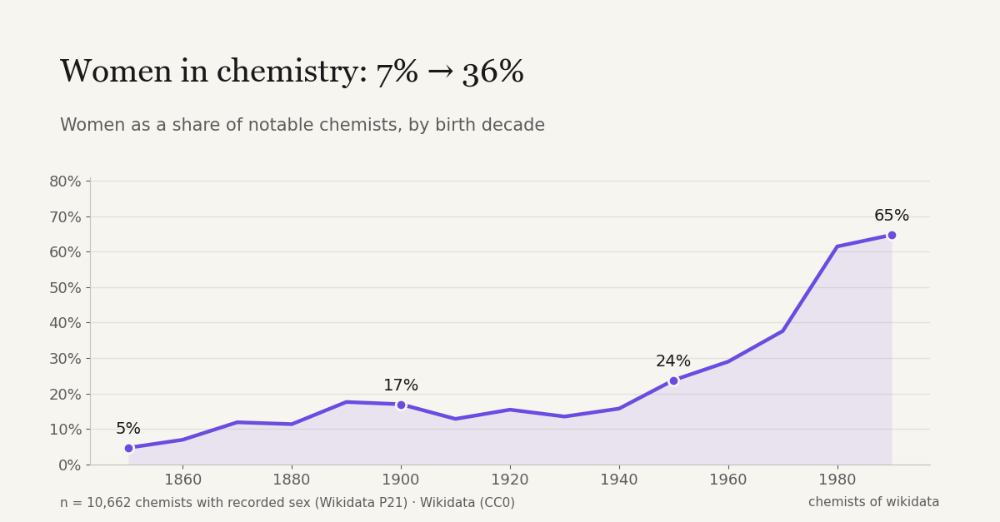
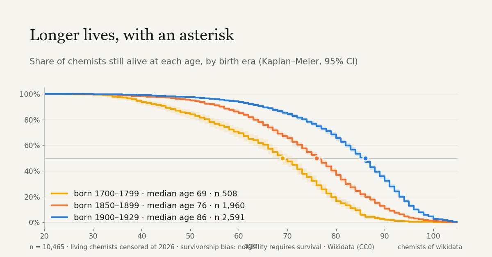
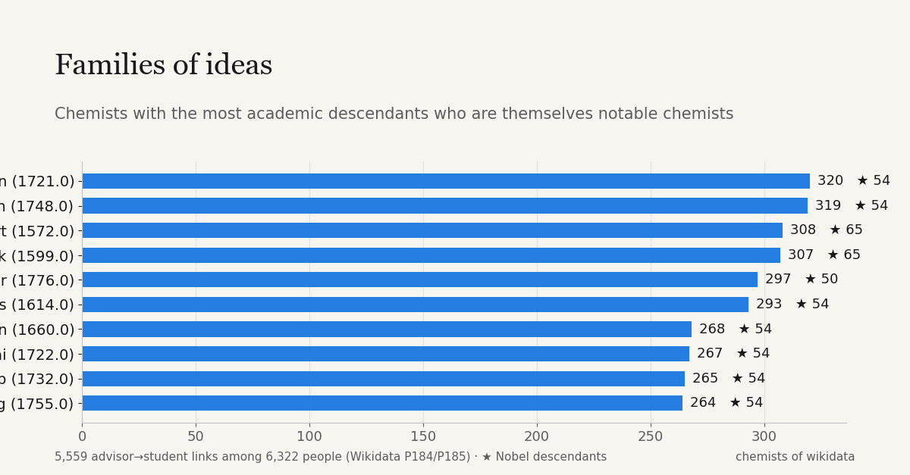
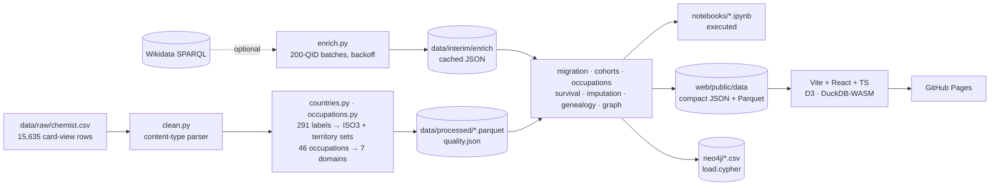

# Chemists of Wikidata

**Three centuries of 11,903 chemists: where chemistry lived, how chemists moved, how long they lived, and who trained whom.**

**Live site → https://ekuelkpodar.github.io/chemists-of-wikidata/**



A reproducible Python pipeline turns a messy Wikidata export into a clean, enriched dataset and seven analyses. A static web app (no backend) then lets anyone explore the results: a migration map, a bar-chart race, Kaplan–Meier curves, academic family trees, and a SQL console running DuckDB in the browser.

## Five findings

Every number below is computed by the pipeline (`src/chemkg/findings.py`), not typed by hand.

**1. Paris → Berlin → America.** Chemistry's center of gravity moved France → Germany (birth cohorts from the 1810s) → the United States (from the 1860s). The US peaked at **41%** of all notable chemists born in the 1910s.


**2. Talent flowed one way.** The US is the great talent magnet, with a net gain of **482** migrant chemists. **Germany → US** is the busiest corridor (70 people). Germany, Austria and Russia are the largest net exporters.


**3. Women: from 7% to 36%.** Women are **7.2%** of notable chemists born before 1900 and **36%** of those born since 1960. The rise isn't monotonic: the share dips for cohorts born 1910–1940, then climbs steeply after 1950.


**4. Longer lives, with an asterisk.** Median age at death rose from **69** (born in the 1700s) to **86** (born 1900–1929). In a Cox model, chemists with more than one citizenship have an 18% lower hazard of death (HR 0.82, 95% CI 0.74–0.91). That is selection, not a benefit of migrating.


**5. Families of ideas.** **21%** of chemists with recorded advisor links (495 of 2,372) belong to one advisor-to-student lineage. Its recorded root is the Renaissance teacher Vittorino da Feltre (b. 1378). Justus von Liebig alone has 262 chemist descendants, and 54 of his academic descendants are Nobel laureates.


## Architecture



| Path | What |
|---|---|
| `src/chemkg/clean.py` | Parses the scraped card view. The QID comes from `explore href`; every cell is classified by content because keys shift. Detects year precision, BCE dates and the likely living, and attaches quality flags |
| `src/chemkg/countries.py` + `resources/country_map.csv` | Hand-curated map of 291 citizenship labels to a modern successor, region, map point and **territory set**. Name change vs. real multi-country affiliation is decided by territory overlap |
| `src/chemkg/enrich.py` + `queries/*.rq` | Advisors, students, awards (Nobel flagged), employers, alma maters, sex, birthplace with coordinates, plus an upward lineage pass. Cached, so the pipeline runs offline |
| `src/chemkg/{migration,cohorts,occupations,survival,imputation,graph,genealogy}.py` | One module per analysis, each with an executed notebook in `notebooks/` |
| `web/` | The static site. Every view reads small pre-aggregated JSON; the Explorer queries `chemists.parquet` with DuckDB-WASM |
| `tests/` | pytest: parsing, country mapping, censoring, migration direction (50 tests) |

## Quickstart

```bash
make setup        # uv venv (Python 3.11) + pinned deps + npm ci
make all          # data → analyses → notebooks → social charts → web build
make dev          # cd web && npm run dev
make test
make enrich       # optional: refresh the SPARQL cache from query.wikidata.org
```

`make all` runs offline: the enrichment responses are committed in `data/interim/enrich/`. CI rebuilds the data from the raw CSV and cache on every push, and fails if the headline outputs differ from the committed ones.

## Data caveats

- **Notability bias.** Only people with a Wikidata item *and* an English Wikipedia article are included. That over-represents anglophone, Western, 20th-century and male chemists. Every share is a share of *notable* chemists.
- **East Asia is nearly invisible.** Japan and China never exceed 3% of a birth cohort. That reflects English Wikipedia, not chemistry.
- **Citizenship ≠ residence.** Migration needs either two territorially distinct citizenships or a birthplace outside every citizenship. Direction comes from place of birth. 196 births in border regions that changed hands (Breslau → Wrocław) are excluded, not counted as moves.
- **Dates.** "1 January" is Wikidata's rendering of year precision; 2,183 birth dates are year-only. Lifespans over 110 or under 15 are flagged as errors and excluded from survival analysis.
- **Survivorship bias.** You have to live long enough to become notable. Living chemists are right-censored, but early-age survival is still overstated.
- **Sparse genealogy.** Advisor links exist for about 2,400 chemists and cluster around famous labs.
- **Quality report:** `data/processed/quality.json`, notebook `01`, and the *Data & methods* page.

## Quality

- **Lighthouse** (mobile emulation): accessibility, best practices and SEO score 100 on every page. Performance is 91 on the landing page and 84–91 on most views. Specialties and Migration fall below 90 on some runs, under 4× CPU throttling, because of the 750 KB people index they parse on load.
- **JavaScript:** about 96 KB gzipped at first load. Each view is lazy-loaded.
- **Charts:** every chart has a table view, an ARIA label, its n and its caveat. Keyboard navigation works throughout, and `prefers-reduced-motion` is respected.

## Citation & license

Data: Wikidata contributors, [CC0 1.0](https://www.wikidata.org/wiki/Wikidata:Licensing); names link to Wikipedia (CC BY-SA). Code: MIT.

> Chemists of Wikidata: an interactive explorer of 11,903 chemists (2026). https://github.com/ekuelkpodar/chemists-of-wikidata

The schema includes `field = "chemistry"` so it can be merged with sibling physics and biology datasets.
